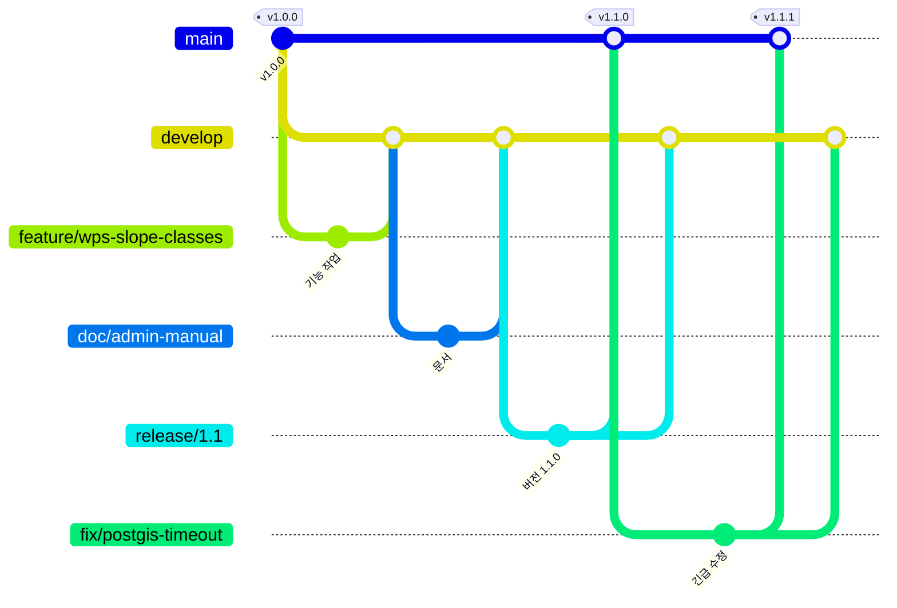

# 브랜치 전략 (안)

> 상태: **제안** — 레포 관리자 확인 후 확정
> 대상: `aliasgis/project_neunggureongi`

모든 변경은 정해진 경로를 거쳐 **최종적으로 `main` 에 도달**한다.
`main` 은 "지금 설치·배포해도 되는 상태"만 담는다.

---

## 1. 현재 상태

| 항목 | 상태 |
|---|---|
| 브랜치 | `main` 하나 |
| 커밋 | 6개 (2026-07-26 ~ 2026-08-16), 모두 `main` 에 직접 커밋 |
| 태그 | 없음 — 어느 커밋이 어느 버전인지 기록이 없다 |
| 버전 표기 | `1.0.0` 이 세 곳에 흩어져 있다 (`app.py` 의 FastAPI `version`, 로그인 화면 `VERSION 1.0.0`, `start_server.ps1` 의 시작 문구) |

지금까지는 혼자 `main` 에 바로 올려도 문제가 없었지만, 함께 작업하거나 설치본을 내보내기 시작하면
"설치한 서버가 어느 코드인지", "작업 중인 기능이 설치본에 섞이지 않았는지"를 답할 수 없게 된다.

---

## 2. 브랜치 구성

### 상시 브랜치 (2개)

| 브랜치 | 역할 | push |
|---|---|---|
| `main` | **출시 라인.** 설치·배포 가능한 상태만. 출시할 때마다 태그를 단다. | **관리자만** |
| `develop` | **통합 라인.** 완료된 작업이 모이는 곳. 다음 출시의 후보. | **관리자만** |

### 기여 원칙

- **`main` 과 `develop` 에는 관리자만 push 할 수 있다.** 그 밖의 모든 기여자는 두 브랜치에 직접 push 하지 않는다.
- 기여자는 **각자 작업 브랜치**(`feature/*`·`fix/*`·`doc/*`·`migration/*`)를 만들어 작업하고,
  **`develop` 으로 PR** 을 올린다. 리뷰를 거쳐 관리자가 머지한다.
- **예외는 두 가지뿐이다.**
  1. **긴급 수정** — 이미 출시한 버전의 결함은 `main` 에서 갈라진 `fix/*` 로 `main` 에 PR 한다(§4.3).
  2. **출시** — `release/*` 를 `main` 으로 머지하는 일은 관리자가 한다(§4.2).
- 관리자도 평소 작업은 같은 방식(작업 브랜치 → `develop` PR)으로 한다. 관리자의 직접 push 는
  출시 머지·태그, 역머지, 저장소 운영처럼 PR 로 하기 어려운 일에만 쓴다.

### 작업 브랜치 그룹 (5종)

| 그룹 | 용도 | 갈라지는 곳 | 합쳐지는 곳 | 예시 |
|---|---|---|---|---|
| `feature/*` | 기능 추가·개선 | `develop` | `develop` | `feature/wps-slope-classes` |
| `fix/*` | 결함 수정 | `develop` (긴급 시 `main`) | `develop` (긴급 시 `main` + `develop`) | `fix/heatmap-radius-unit` |
| `doc/*` | 문서만 바꾸는 변경 | `develop` | `develop` | `doc/branch-strategy` |
| `migration/*` | 큰 구조 변경·의존성 일괄 상향·데이터 이관 | `develop` | `develop` | `migration/python-3-12` |
| `release/*` | 출시 준비(버전 올림·최종 점검) | `develop` | `main` (+ `develop` 역머지) | `release/1.1` |

이 다섯 가지 외의 접두사(`feat/`, `docs/`, `hotfix/`, `chore/` 등)는 쓰지 않는다.
비슷한 이름이 섞이면(`feat`·`feature`, `doc`·`docs`) 찾기도 정리하기도 어려워진다.

---

## 3. 흐름



경로를 한 줄로 쓰면:

```
feature/* · fix/* · doc/* · migration/*  ──PR──▶  develop  ──▶  release/X.Y  ──PR──▶  main (+태그)
                                                                     └──역머지──▶  develop
긴급: main ──▶ fix/*  ──PR──▶  main (+태그)  그리고  ──PR──▶  develop
```

---

## 4. 그룹별 규칙

### 4.1 `feature/*` · `fix/*` · `doc/*` · `migration/*`

1. 최신 `develop` 에서 만든다.
   ```bash
   git switch develop && git pull --ff-only
   git switch -c feature/<짧은-설명>
   ```
2. 작업하고 커밋한다. 한 브랜치에는 한 가지 목적만 담는다.
3. `develop` 으로 PR 을 연다. 본문에 **무엇을·왜·어떻게 확인했는지** 적는다.
4. 리뷰를 받아 머지한다. 머지 방식은 **squash** 를 기본으로 한다(`develop` 이력이 PR 단위로 깔끔하게 남는다).
5. 머지한 브랜치는 지운다.

`doc/*` 는 코드를 바꾸지 않는다. 코드와 문서를 같이 바꾸면 `feature/*` 나 `fix/*` 로 만든다.

`migration/*` 는 영향이 넓으므로 PR 에 **되돌리는 방법**도 적는다.
(예: `requirements.txt` 일괄 상향 → 이전 버전 고정 목록 첨부)

### 4.2 `release/X.Y` — 출시 준비

1. 출시할 기능이 `develop` 에 모이면 `release/<메이저>.<마이너>` 를 만든다.
   ```bash
   git switch develop && git pull --ff-only
   git switch -c release/1.1
   ```
2. 이 브랜치에서는 **버전 올림과 출시 전 수정만** 한다. 새 기능은 넣지 않는다(다음 출시로).
3. 점검 목록(§6)을 통과하면 `main` 으로 PR 을 열고 **merge commit** 으로 머지한다
   (squash 하면 `develop` 과 조상이 갈라져 다음 출시 때 충돌이 반복된다).
4. `main` 의 머지 커밋에 태그를 단다 (§5).
5. `release/X.Y` 를 `develop` 으로 다시 머지한다 — 출시 준비 중 고친 내용이 `develop` 에서 사라지지 않게.
6. 같은 `X.Y` 의 패치 출시(`1.1.1`, `1.1.2`)가 이어질 수 있으므로 `release/X.Y` 는 **다음 마이너가 출시될 때까지 남겨둔다.**

### 4.3 긴급 수정 — 이미 출시한 버전의 결함

`hotfix/` 접두사를 따로 두지 않고 `fix/*` 를 쓰되, 갈라지는 곳만 다르다.

1. `main`(또는 해당 `release/X.Y`)에서 `fix/<설명>` 을 만든다.
2. 수정 후 `main` 으로 PR → 머지 → 패치 버전 태그(`v1.1.1`).
3. **같은 수정을 반드시 `develop` 에도 반영한다** (PR 로 머지하거나 cherry-pick).
   빠뜨리면 다음 출시에서 같은 결함이 되살아난다.
4. 역머지할 때는 덮어쓰지 말고 diff 를 확인한다. `develop` 에만 있는 변경이 지워지지 않았는지 본다.

---

## 5. 버전과 태그

### 버전 번호 — `메이저.마이너.패치`

| 자리 | 올리는 때 | 예 |
|---|---|---|
| 메이저 | 호환이 깨지는 변화 — `layers.csv` 형식 변경, API 경로 변경, 설치 방식 변경 | `1.x` → `2.0.0` |
| 마이너 | 기능 추가 — 새 WPS 플러그인, 새 레이어 형식 지원 | `1.0` → `1.1.0` |
| 패치 | 결함 수정만 | `1.1.0` → `1.1.1` |

**버전 번호는 한 곳에만 둔다.** 지금은 `1.0.0` 이 세 곳에 따로 적혀 있어 하나만 고치면 서로 어긋난다.
`version.py`(예: `__version__ = "1.0.0"`) 하나를 만들고 `app.py`·로그인 화면·`start_server.ps1` 이
그 값을 읽도록 바꾸는 것을 첫 `release/*` 전에 `fix/*` 로 처리하기를 제안한다.

### 태그

- 출시할 때마다 `main` 의 해당 커밋에 **annotated 태그**를 단다: `v1.1.0`
- 메시지에 출시일과 주요 변경을 적는다.
  ```bash
  git tag -a v1.1.0 -m "v1.1.0 (2026-11-20) — WPS 경사 등급 추가, 히트맵 반경 수정"
  git push origin v1.1.0
  ```
- 태그를 기준으로 GitHub Release 를 만들고 변경 내역을 적는다.
- 설치본(zip 등)을 따로 배포한다면 Release 에 첨부하고 SHA-256 을 적는다.

---

## 6. 출시 전 점검 (`release/*` → `main` PR 에서)

- [ ] 버전 번호를 올렸다 (한 곳)
- [ ] 깨끗한 환경에서 `install_and_run.bat` 로 설치·기동된다
- [ ] WMS·WFS·WCS·WPS `GetCapabilities` 가 응답한다
- [ ] 샘플 레이어(`sample_dem`·`sample_area`·`sample_cad`) `GetMap` 이 이미지를 그린다
- [ ] PostGIS 를 쓰는 경우 `/api/postgis/health` 가 정상이다
- [ ] `layers.csv` 에 레포에 없는 파일을 가리키는 레이어가 없다 (아래 §8)
- [ ] 비밀값(`.admin.key`, `data/admin_credentials.bin`, `data/postgis_connections.bin`, 실제 DB 비밀번호)이 커밋에 없다
- [ ] 변경 내역을 Release 노트로 정리했다

---

## 7. GitHub 설정 제안

| 설정 | `main` | `develop` |
|---|---|---|
| push 를 관리자로 제한 (Restrict who can push) | ✅ | ✅ |
| 그 밖의 기여자는 PR 필수 | ✅ | ✅ |
| 승인 1명 이상 | ✅ | ✅ (혼자일 때는 생략 가능) |
| force push · 삭제 금지 | ✅ | ✅ |
| 허용 머지 방식 | merge commit | squash (+ `release/*` 역머지용 merge commit) |

- 기본 브랜치(default branch)를 `develop` 으로 바꾸면 PR 이 자연스럽게 `develop` 으로 열린다.
  다만 레포를 처음 보는 사람이 `develop` 을 먼저 보게 되므로, README 에 "설치는 최신 Release 태그를 쓰라"고 적는다.
- 머지한 작업 브랜치 자동 삭제(Automatically delete head branches)를 켠다.

---

## 8. 도입 순서

지금 `main` 하나뿐이므로 다음 순서로 옮긴다.

1. **`develop` 생성** — 현재 `main` 최신(`89afb00`)에서 `develop` 을 만들어 push 한다.
2. **첫 사례: 이 문서** — 이 문서는 `doc/branch-strategy` 브랜치에서 작성해 **`develop` 으로 PR** 한다.
   앞으로의 모든 기여가 이 모양을 따른다: 작업 브랜치 → `develop` PR → 리뷰 → 관리자 머지.
3. **기준점 태그** — `89afb00` 이 `1.0.0` 으로 배포된 코드가 맞는지 확인하고 `v1.0.0` 태그를 단다.
4. **보호 규칙 설정** (§7) — `main`·`develop` push 를 관리자로 제한한다.
5. 이 문서는 다음 `release/*` 때 `main` 에 함께 도달한다.

도입하면서 함께 정리하면 좋은 것:

- `layers.csv` 가 레포에 없는 업로드 파일(`data/uploads/...`)과 레포에 없는 PostGIS 연결(`connection_id`)을 가리키는 레이어 4개를 담고 있다.
  새로 클론하면 이 레이어들이 오류를 낸다. 레포에는 샘플 레이어만 두고, 실제 운영 레이어 목록은 각 서버에서 관리하는 편이 안전하다 → `fix/*` 로 처리.
- 서버가 실행 중에 만드는 `cache/` 폴더와, 암호화된 PostGIS 연결 정보 파일 `data/postgis_connections.bin` 이 `.gitignore` 에 없다.
  특히 후자는 실수로 커밋하기 쉽다 → `fix/*` 로 처리.
- 버전 번호를 한 곳으로 모은다(§5) → `fix/*` 로 처리.

---

## 9. 커밋 메시지

```
<요약 한 줄 — 무엇을 했는지>

<필요하면 본문 — 왜 바꿨는지, 어떻게 확인했는지>

Refs #<이슈 번호>
```

- 요약은 한국어로, 50자 안팎.
- 한 커밋에는 한 가지 변경만. "기능업데이트"처럼 내용을 알 수 없는 요약은 피한다.
